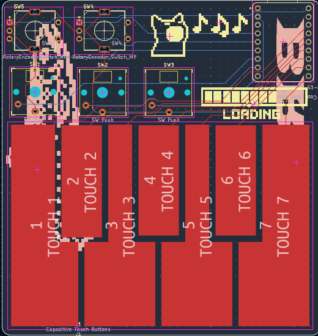
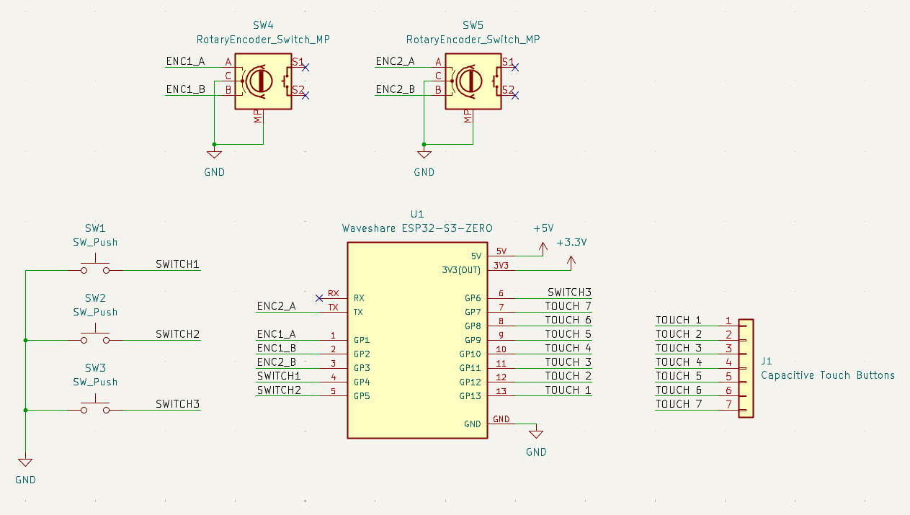
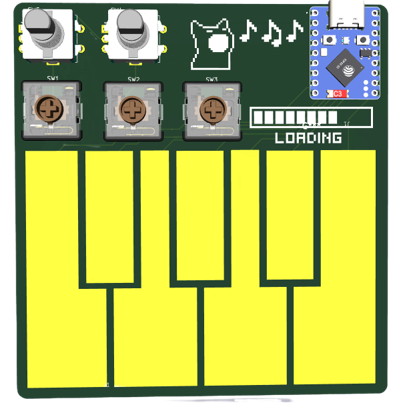
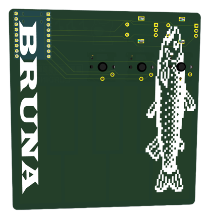

# Midi Keypad
building a mini portable keypad

My Interest have always been diverse, but music and electronics are the ones I constantly find myself drawn back to. With this project I am connecting both, by merging the 
creative and expressive qualities of music with the physical and technical structure of electronics. 

## Progress

### Schematic

Because I didn't want to use Bourns potentiometer sliders in my keypad I needed to replace them with a different component. 
I decided to add another encoder because I find them visually pleasing. Initially I wanted to use three encoders, but due to a shortage of GPIOs pins that wans't possible. 

I also had to adjust the connections between the different components and the ESP32 to make PCB routing easier

### Design

### Next steps ... 

  - firmware
  - assemble it

## BOM

| Item | Qty | Supplier | Cost/item | Total Cost | Link |
|---|---:|---|---:|---:|---|
| Key Caps (Encoders) | 1 | Aliexpres | $1.84 | $1.84 | [Link](https://de.aliexpress.com/item/4000326517211.html) |
| ESP32-S3-Zero | 1 | aliexpress | $5.62 | $5.62 | [Link](https://de.aliexpress.com/item/1005012733231291.html) |
| key switches | 1 | Aliexpress | $3.51 | $3.51 | [Link](https://de.aliexpress.com/item/1005013073233639.html) |
| The PCB | 1 | JLCPCB | $5.30 | $5.30 | [Link](https://www.jlcpbc.com) |
| EC11 | 1 | aliexpress | $3.31 | $3.31 | [Link](https://de.aliexpress.com/item/4000326517211.html) |
| Estimated total shipping | 1 | | | $23.40 | |
